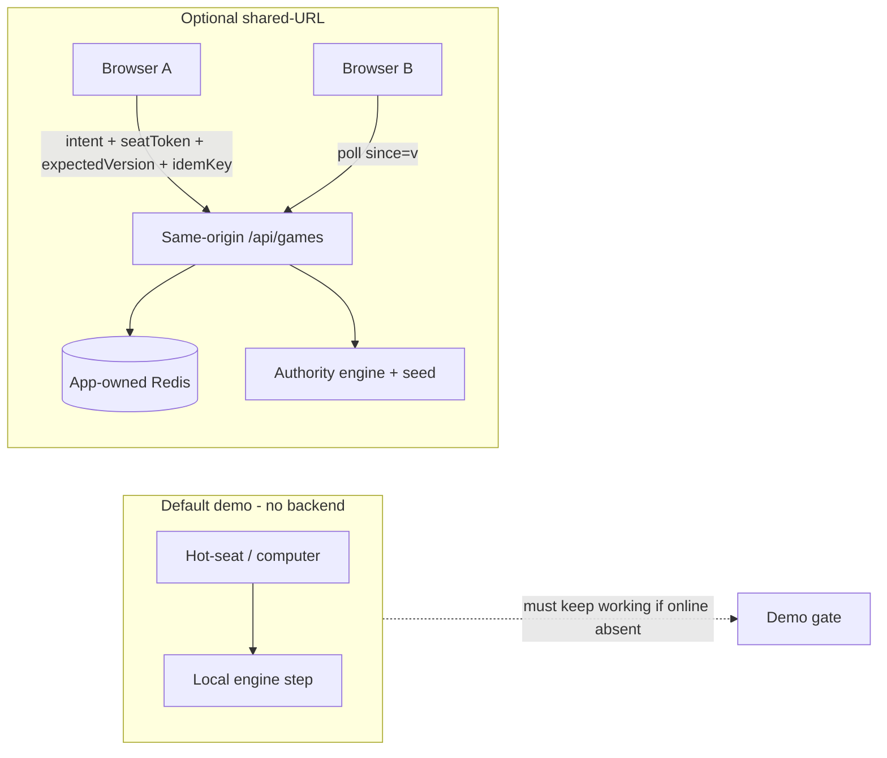

# BTT-27 — Multiplayer reuse adaptation contract

**Date:** 2026-11-07  
**Status:** Design only. No implementation, no spend, no Done.

## Recommendation

Adopt the merged reuse draft as the base contract, with the decisions below folded in before BTT-28 starts. Optional shared-URL play is an isolated online adapter over the existing engine. It does not replace hot-seat or computer play. It does not weaken [001: static site with no backend](../decisions/001-static-no-backend.md) for the default path: plain static files on a CDN, no server, accounts, or runtime AI calls. It does not authorize attaching or reusing stores or credentials.

Downstream: BTT-28 (create/join) and BTT-29 (sync/rejoin) stay no-go for production authority until a person attaches an app-owned store to this app, or an already-available in-environment credential appears without copying from the stopped reference app.

---

## 1. Provenance (observed vs substitute)

| Source | Status | Notes |
|---|---|---|
| Merged reuse draft `docs/shared-url-reuse-contract.md` | **Observed** | Docs only; no product code. The draft labeled itself investigation-only. |
| Stopped reference `packages/online/**` | **Observed on a later read** | Handlers, store, Redis, and client online paths were readable. The first draft's environment could not read that repository. That limitation stands for the draft. The later read found the same HTTP and Redis shape. |
| Reference production deployment file tree | **Substitute used by the first draft** | A deployed snapshot, not proven bit-identical to the reference repository head. Its HTTP and Redis description matches `packages/online` and the reference Track E note (poll plus Upstash Redis compare-and-swap). Colyseus stays deferred. |
| [001: static site with no backend](../decisions/001-static-no-backend.md) | **Observed** | Default is a static CDN with no backend. Online play is a revisit trigger, not a silent override. |
| This app's hosted environment / store | **Observed by the first draft** | No environment variables and no app-attached store. Not independently re-audited in the later read. Treat as binding until contradicted. |
| Credentials / Redis contents | **Not retrieved** | Do not copy the reference app's Redis store into this app. |

**Labeling rule:** Cite `packages/online` paths for file and behavior claims. When only the deployed snapshot was available, call it substitute provenance. Do not publish deployment identifiers.

---

## 2. What is reusable (adapt, don't copy)

From the reference `packages/online` and the merged draft (aligned with Track E):

| Behavior | Where (reference) | Adapt for this app |
|---|---|---|
| Store port: create-if-absent, read, event tail, commit-at-version → `ok` / `mismatch` / `missing`, ping | `store.ts`, `memory-store.ts`, `redis-store.ts` | Same port plus a memory implementation for box tests with no network |
| Atomic Redis version script + 7-day TTL on doc + events | `redis-store.ts`, `script.ts` | Same shape once this app has its own key-value store |
| HTTP: `POST /api/games`, `POST …/join`, `GET …?since=`, `POST …/intents`; 409 → client reload | `handlers.ts`, `apps/client/src/online/remote.ts` | Same; poll while the document is visible (~1.5s, then backoff) |
| Seat token in `localStorage`; never in URL | client online | Keep |
| Invite + seat tokens hashed at rest; raw invite once to creator | `tokens.ts`, handlers | Keep |
| Authority holds seed; clients send intents only | handlers + RNG | Authority grades the quiz and rolls; clients never see `correctLetter` / `correctAnswer` in the public view |
| Hot-seat / vs-computer stay local | client modes | Hard requirement. If online is down, the demo still plays. |

---

## 3. Unsupported / must not copy

| Item | Why |
|---|---|
| Player cap 2–4 / seat index >3 unreadable | This app seats **2–6** |
| Reference rules, 60-minute cap, place-value formula, room-server hello room, AI ticket / `TYPESAFE_API_KEY` path | Different product |
| Publishing full rules/`GameState` including the quiz answer key | A public poll would leak answers. Project a sanitized public view (holdings, phase, prompt, choice order). The correct letter stays on the authority. |
| Embedding the full map and quiz pack in every Redis document | Carry pack digests and play state. Static packs are already on both clients. |
| Blind retry of intents after a lost success | Version compare-and-swap is not idempotency. **BTT-29 must add `idempotencyKey` (or equivalent) stored with the committed version.** The reference client and the merged draft correctly record that `idempot` is absent. |
| Reusing the reference app's Redis store or copying its environment | Cross-game data, plus unauthorized spend or credential reuse |
| Routing hot-seat through the network | Breaks demo isolation and decision 001 |
| Assuming a long-lived WebSocket host | Rejected for this optional path (Track E). Keep polling and functions. |

---

## 4. Authority, revision, credentials

| Concern | Decision | Rationale |
|---|---|---|
| Authoritative state | A same-origin function plus store owns the canonical document. Clients are views and intent senders. | Matches the reference. Required for shared turns. |
| Turn / seat authorization | An intent must present a seat token matching the hashed seat, and it must be that seat's turn. | Existing handler pattern |
| Concurrency | Optimistic `expectedVersion` plus an atomic commit. Mismatch returns 409 and the client refetches. | Covered by the reference tests |
| Idempotency | **Required for BTT-29** before claiming resilient sync | Compare-and-swap alone can apply a retried, still-legal intent twice |
| Outcome generation | The authority runs the engine, the random source, and quiz grading | The answer key never enters the public view |
| Rejoin | Seat token in `localStorage`, keyed by game id. Polling restores state. No presence is required in the first version. | Same as the reference |
| Invite in the query string | **Open owner decision before BTT-28 merges:** keep `?i=` (log and history leak) or use a fragment, a path, or a paste after join. The seat token stays out of the URL. | The merged draft left this explicit |
| Default product path | Static hot-seat and computer play, per decision 001 | Online is an opt-in entry. Hide or disable it if the health ping fails. |

---

## 5. Compatibility with the static-site decision

The accepted decision in [`decisions/001-static-no-backend.md`](../decisions/001-static-no-backend.md) is: plain static files on a CDN; no server, accounts, or runtime AI calls. Online play is allowed only as a later, explicit revisit. The path `scope/decisions/001-static-no-backend.md` is not in this repository.

| Rule | Contract |
|---|---|
| Default ship | Static files; no accounts; no required runtime backend |
| Optional online | Separate entry ("Play online"); feature-detected via health; never blocks hot-seat |
| Quiz UI copy | Keep `Questions unverified`; no replacement trivia bank in this slice |
| Spend | No new paid database or plan upgrade without an owner decision. The free-plan one-database limit means a new store for this app is a human cost and configuration decision. |
| Privacy | Still no user accounts. Seat tokens are unguessable secrets, not identities. |

---

## 6. Who may do what

| Surface | Limit |
|---|---|
| This contract and the reuse draft | Docs only. No second implementation pull request from this work. |
| BTT-28 / BTT-29 implementation | After this contract passes independent review and a store exists |
| Stopped reference app | Read-only. No edits and no credential reuse. |
| Store attach and hosted environment for this app | A person. Document the steps. Do not provision or spend. |

---

## 7. Go / no-go prerequisites

### BTT-28 create/join — no-go until

1. Independent review accepts this contract and the merged draft, with the invite-URL decision recorded.
2. A person attaches a store owned by this app, or documents an approved zero-spend path, and server-only environment (`KV_REST_*` or equivalent). Do not copy the reference app's environment.
3. The public view schema excludes quiz answer fields, at the type level and in tests.
4. Seats 2–6 are encoded in the create/join API and in client checks.
5. Hot-seat and computer paths are unchanged and still pass box gates without Redis.
6. Memory-store tests are green with no network.

### BTT-29 sync/rejoin — no-go until BTT-28's gates, plus

1. An idempotency key on intents, persisted with the version.
2. Two independent browser contexts: join, act, see the peer update, refresh/rejoin, and a stale 409.
3. `npm run box` green, with the command output recorded, and exact-head independent approval before merge.
4. The online entry is hidden or disabled when the health ping fails.

### Explicit unknowns

- Whether this repository's hosting name and the hosted project name are the same binding.
- Whether a free key-value plan allows a second database on the same account without a paid upgrade. The first draft reported a one-database free limit. Treat that as a likely blocker.
- Where the invite belongs in the share URL. That is an open owner decision before BTT-28.
- Which implementer picks up the work after review.

No waiver of these gates is recorded here.

---

## 8. Evaluation of the merged draft

| Criterion | Verdict |
|---|---|
| Scope discipline (docs only, no Done, no BTT-28/29 code) | Pass |
| Provenance honesty (repository unreadable in the first environment; deployment snapshot used as a substitute) | Pass. A later read of `packages/online` found no contradiction with the draft's Redis and HTTP claims. |
| Reuse versus non-copy list | Pass. Answer-key leak, seat cap, idempotency, and store isolation are called out. |
| Static demo boundary | Pass |
| Ready as final architecture | No. The invite URL is still open, independent review is still required, and the store gate is still closed. |

**Disposition:** The merged draft is the base contract. The invite URL stays an owner decision before BTT-28. This file holds the adaptation decisions. `packages/online` was read on 2026-11-07.

---

## 9. Where to look

- Adaptation decisions: this file
- Investigation draft: `docs/shared-url-reuse-contract.md`
- Reference behavior: stopped reference `packages/online/src/{handlers,redis-store,store,view,tokens}.ts` and `apps/client/src/online/remote.ts` (read-only)
- Reference track: poll plus Redis compare-and-swap; room server deferred
- Static decision: [`decisions/001-static-no-backend.md`](../decisions/001-static-no-backend.md)
- Dependents: BTT-28 and BTT-29, both unimplemented

---

## 10. Out of scope for BTT-27

Implementation, service provisioning, credential retrieval, competing pull requests, marking stories Done, hosted CI or previews as merge proof, changing the stopped reference app, and replacing the demo engine.
