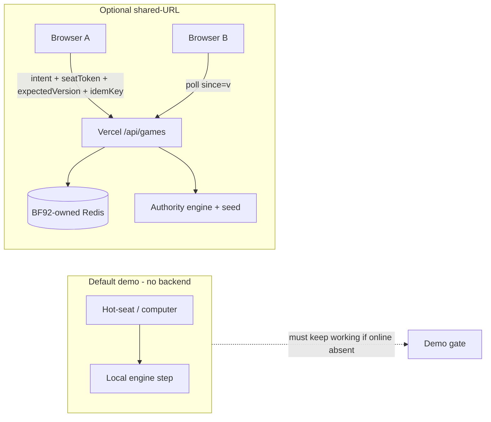

# BTT-27 — Multiplayer reuse adaptation contract (Architect)

**Story:** [BTT-27](https://traverseit.io) `sty_82e08b75` · **Scope:** `battlefor92` · **Author:** Architect · **Date:** 2026-11-07 (America/Indianapolis)  
**Status:** Ready for independent review (design only; no implementation, no spend, no Done)

## Recommendation

**Adopt PR [#32](https://github.com/squashy/indyinit/pull/32) @ `2e91c2f31c154d29a1a06689b6046507a1e09a9f` as the base reuse contract**, with the Architect decisions below folded in before BTT-28 starts. Optional shared-URL play is an **isolated online adapter** over the existing engine. It does **not** replace hot-seat / computer demo, does **not** weaken [001-static-no-backend](../scope/decisions/001-static-no-backend.md) for the default path, and does **not** authorize attaching or reusing stores/credentials.

Downstream: BTT-28 `sty_6ab383ae` (create/join) and BTT-29 `sty_c79cae9c` (sync/rejoin) stay **no-go for production authority** until a human attaches an **app-owned** store to `battlefor92` (or an already-available in-env credential appears without copying from `hoosier-conquest`).

---

## 1. Provenance (OBSERVED vs substitute)

| Source | Status | Notes |
|---|---|---|
| GitHub PR32 `docs/shared-url-reuse-contract.md` @ `2e91c2f…` | **OBSERVED** | Single-file doc PR; no product code. Author correctly labeled investigation-only. |
| Origin `whackysaltine/risk-game` `packages/online/**` | **OBSERVED (this Architect session)** | Directory and handlers/store/redis/client online paths readable via Origin tools. Author reported Origin unreadable in *their* environment — that limitation is accepted for their draft; Architect independently verified the package shape matches the draft. |
| Vercel deploy `dpl_Cwa9dVGjXNecJDodrRSoeu6MYi1n` (`hoosier-conquest`) | **SUBSTITUTE used by author** | Deployed snapshot, not proven bit-identical to Origin HEAD. Author’s HTTP+Redis description is consistent with Origin `packages/online` and local `/workspace/risk-game/v1-hardcut.md` Track E (Upstash Redis CAS). |
| Local Architect docs `/workspace/risk-game/{architecture.md,v1-hardcut.md}` | **OBSERVED** | Track E: poll + Redis CAS; Colyseus deferred. |
| Local BattleFor92 `scope/decisions/001-static-no-backend.md` | **OBSERVED** | Default = static CDN, no backend. Online is a revisit trigger, not a silent override. |
| `battlefor92` Vercel env / store | **OBSERVED (author)** | No env vars; no app-attached store. Not independently re-audited here; treat as binding until contradicted. |
| Credentials / Redis contents | **NOT RETRIEVED** | Do not copy `hoosier-conquest-kv` into BattleFor92. |

**Labeling rule:** Prefer Origin citations for file/behavior claims. Where only the deploy tree was used historically, keep the `dpl_…` id and call it substitute provenance.

---

## 2. What is reusable (adapt, don’t copy)

From Origin `packages/online` + PR32 (aligned with Track E):

| Behavior | Where (Origin) | Adapt for BattleFor92 |
|---|---|---|
| Store port: create-if-absent, read, event tail, commit-at-version → `ok` / `mismatch` / `missing`, ping | `store.ts`, `memory-store.ts`, `redis-store.ts` | Same port + memory impl for box tests with no network |
| Atomic Redis version script + 7-day TTL on doc + events | `redis-store.ts`, `script.ts` | Same shape once BF92 has its own KV |
| HTTP: `POST /api/games`, `POST …/join`, `GET …?since=`, `POST …/intents`; 409 → client reload | `handlers.ts`, `apps/client/src/online/remote.ts` | Same; poll while document visible (~1.5s → backoff) |
| Seat token in `localStorage`; never in URL | client online | Keep |
| Invite + seat tokens hashed at rest; raw invite once to creator | `tokens.ts`, handlers | Keep |
| Authority holds seed; clients send intents only | handlers + RNG | Authority grades quiz / rolls; clients never see `correctLetter` / `correctAnswer` in the public view |
| Hot-seat / vs-computer stay local | client modes | **Hard requirement** — online down must not break demo |

---

## 3. Unsupported / must not copy

| Item | Why |
|---|---|
| Player cap 2–4 / seat index >3 unreadable | BattleFor92 seats **2–6** |
| Hoosier rules, 60-min cap, place-value, Colyseus hello room, AI ticket / `TYPESAFE_API_KEY` path | Different product |
| Publishing full rules/`GameState` including quiz answer key | Public poll would leak answers — project a **sanitized public view** (holdings, phase, prompt, choice order; correct letter stays on authority) |
| Embedding full map + quiz pack in every Redis doc | Carry pack digests + play state; static packs already on both clients |
| Blind retry of intents after lost success | Version CAS is not idempotency; **BTT-29 must add `idempotencyKey` (or equivalent) stored with the committed version** — Origin/PR32 correctly flag absence (`idempot` not in shipped client) |
| Reusing `hoosier-conquest-kv` or copying its env | Cross-game data + unauthorized spend/credential reuse |
| Routing hot-seat through the network | Violates demo isolation and 001 |
| Assuming Colyseus / long-lived WS host | Rejected for this optional path (Track E); keep polling+functions |

---

## 4. Authority, revision, credentials (decision table)

| Concern | Decision | Rationale |
|---|---|---|
| Authoritative state | Server (Vercel function + store) owns canonical doc; clients are views + intent senders | Matches reference; required for shared turns |
| Turn / seat authorization | Intent must present seatToken matching hashed seat; must be that seat’s turn | Existing handlers pattern |
| Concurrency | Optimistic `expectedVersion` + atomic commit; mismatch → 409 + refetch | Proven in reference tests |
| Idempotency | **Required for BTT-29** before claiming resilient sync | CAS alone can double-apply a retried still-legal intent |
| Outcome generation | Authority runs engine + RNG + quiz grading | Answer key never in public view |
| Rejoin | Seat token in localStorage keyed by gameId; poll restores state; no presence required in v1 | Same as reference |
| Invite in query string | **Open decision before BTT-28 merge:** keep `?i=` (log/history leak) vs fragment/path/post-join paste. Seat-token-never-in-URL stays fixed. | PR32 correctly left this explicit |
| Default product path | Static hot-seat / computer per 001 | Online is opt-in entry; hide or disable if health ping fails |

---

## 5. Compatibility with 001-static-no-backend

| Rule | Contract |
|---|---|
| Default ship | Static files; no accounts; no required runtime backend |
| Optional online | Separate entry (“Play online”); feature-detected via health; never blocks hot-seat |
| Quiz UI copy | Keep `Questions unverified`; no replacement trivia bank in this slice |
| Spend | No new paid DB / plan upgrade without Ryan; free-plan one-DB constraint means **new store for BF92 is a human cost/config decision** |
| Privacy | Still no user accounts; seat tokens are unguessable secrets, not identities |

---

## 6. Ownership map (no competing worker)

| Surface | Owner | Notes |
|---|---|---|
| PR32 draft text `docs/shared-url-reuse-contract.md` | Existing author agent `bc-0ab37679-0797-50d1-b9c6-e469838076e1` | Architect evaluates; does not fork a second implementation PR |
| This Architect decision overlay | Architect (`agt_ecd8f11e`) | Board story BTT-27; fold deltas into PR32 or a follow-up doc commit by the author |
| BTT-28 / BTT-29 implementation | Builder lane (or designated implementer after store exists) | After this contract passes independent review + store gate |
| risk-game / Hoosier Conquest | **STOPPED** — read-only reference | No edits, no credential reuse |
| Store attach / Vercel env on `battlefor92` | Ryan (human) | Architect/Builder may document steps; must not provision spend |

---

## 7. Go / no-go prerequisites

### BTT-28 create/join — **NO-GO until**
1. Independent review accepts this contract + PR32 (with invite-URL decision recorded).
2. Human attaches a **BattleFor92-owned** store (or documents an approved zero-spend path) and server-only env (`KV_REST_*` / equivalent) — **not** copied from hoosier-conquest.
3. Public view schema excludes quiz answer fields (type-level + tests).
4. Seats 2–6 encoded in create/join API and client checks.
5. Hot-seat/computer paths unchanged and still pass box gates without Redis.
6. Memory store tests green with no network.

### BTT-29 sync/rejoin — **NO-GO until** BTT-28 gates plus
1. Idempotency key on intents (persist with version).
2. Two independent browser contexts: join, act, see peer update, refresh/rejoin, stale 409.
3. `npm run box` (or project canonical box gate) green with evidence pasted; exact-head independent approval before merge.
4. Online entry hidden/disabled when health fails.

### Explicit unknowns (allowed; do not fake as settled)
- Exact Vercel project slug binding for BattleFor92 vs indyinit hosting name.
- Whether free Upstash allows a second DB under the same account without paid upgrade (author reported one-DB free limit — treat as likely blocker).
- Invite URL placement preference (Ryan/PO).
- Whether implementer is squashy-gb-chuck vs Builder after review.

---

## 8. PR32 evaluation (Architect)

| Criterion | Verdict |
|---|---|
| Scope discipline (docs only, no Done, no BTT28/29 code) | **Pass** |
| Provenance honesty (Origin fail + deploy substitute) | **Pass** — Architect later verified Origin; no contradiction found with draft’s Redis/HTTP claims |
| Reuse vs non-copy list | **Pass** — answer-key leak, seat cap, idempotency, store isolation correctly called out |
| Static demo boundary | **Pass** |
| Ready to rubber-stamp as final architecture | **No** — needs invite-URL decision, Architect overlay merge, independent review, store gate |

**Disposition:** Approve as **draft contract base**. Request author (or a single follow-up doc commit) to append: (1) invite-URL decision placeholder resolved or explicitly “Ryan decides before BTT-28”, (2) link to this Architect overlay, (3) Origin citation note that Architect verified `packages/online` on 2026-11-07.

---

## 9. Links

- PR: https://github.com/squashy/indyinit/pull/32 @ `2e91c2f31c154d29a1a06689b6046507a1e09a9f`
- Origin reference (read-only): https://cursor.com/codebase/whackysaltine/risk-game (esp. `packages/online/src/{handlers,redis-store,store,view,tokens}.ts`, `apps/client/src/online/remote.ts`)
- Substitute deploy id: `dpl_Cwa9dVGjXNecJDodrRSoeu6MYi1n`
- Local Track E: `/workspace/risk-game/v1-hardcut.md` §Track E
- Local architecture: `/workspace/risk-game/architecture.md`
- Static decision: `/workspace/battlefor92/scope/decisions/001-static-no-backend.md`
- Dependents: `sty_6ab383ae`, `sty_c79cae9c`
- Running author agent: https://cursor.com/agents/bc-0ab37679-0797-50d1-b9c6-e469838076e1

---

## 10. Out of scope for BTT-27

Implementation, service provisioning, credential retrieval, competing PRs, auto-Done, hosted CI/previews as merge proof, changing stopped risk-game, replacing demo engine.
